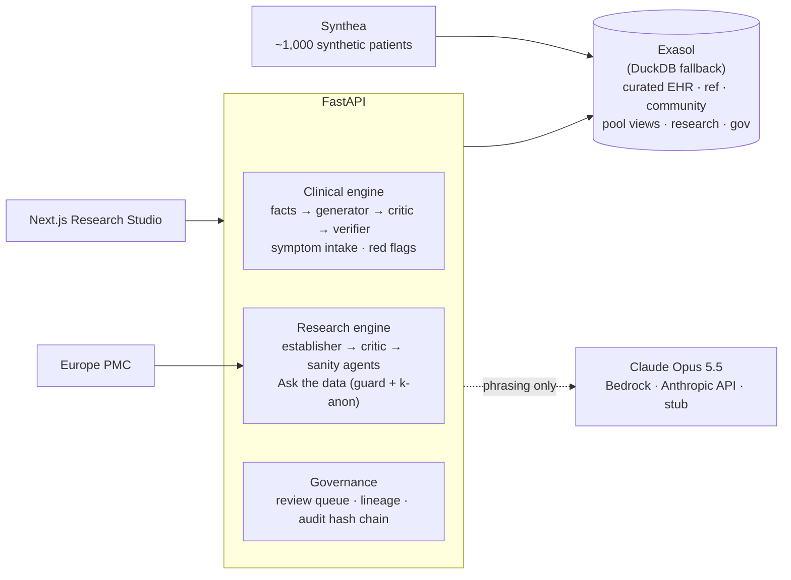

<div align="center">

# 🔍 TrustLens

### Would you trust an AI with your health? Only if you can check it.

**Every AI sentence is backed by data you can click through to, checked by other agents,<br/>and signed off by a human where it matters.**

[](https://github.com/NavneetKishanS/trust-lens/actions/workflows/ci.yml)


[**Live demo**](https://trustlens-eta-self.vercel.app) · [API docs](https://trustlens-api-snowy.vercel.app/docs) · [Architecture](docs/architecture.md) · [Contracts](docs/context/00-shared.md)

<sub>Built at the Exasol × Medical Valley EMN Healthcare Hackathon Bayern · Erlangen · November 2026</sub>

</div>

---

## The problem

AI summaries of medical records are fluent, fast and impossible to verify. A single wrong number or invented diagnosis
destroys trust, and a hidden one is worse. TrustLens flips the default: **SQL and rules decide, the LLM only phrases**,
and every output can be traced back to the row it came from.

## Who it's for

| | User | What they get |
|---|---|---|
| 🧑 | **Patient** | A plain-language overview of their records and labs (*"your blood sugar was high in March, now it's in the usual range"*). No diagnoses, no advice. New symptoms they report are classified: listed side effects go to statistics, unexpected ones go to a clinician. |
| 🩺 | **Physician** | The same overview with clinical codes and clickable lineage, plus a review queue. The AI summarises; it never tells the doctor what to do. |
| 🔬 | **Researcher** | A knowledge graph of papers where every relation is established, criticised and sanity-checked by three agents, each with a verbatim quote and link. An anonymised patient pool with validated rare cases, and **Ask the data** with the SQL shown and small counts suppressed. |

## How trust is built in

| Guarantee | How |
|---|---|
| **Click any sentence → see its source** | Every sentence cites fact IDs. Lineage shows the source rows, the agent, the model and the prompt hash. |
| **A critic checks every number** | A deterministic critic verifies each number, date and medical term against the cited facts (±0.1, unit-aware), plus an LLM entailment verifier. Anything unsupported goes to human review, never a silent OK. |
| **Banned language by audience** | Patient text can't say "you have", "diagnosis", "should take" or give doses. Physician text can't "recommend" or "consider prescribing". |
| **Red flags escalate immediately** | Chest pain, shortness of breath, one-sided weakness and other red flags are detected deterministically, jump to the top of the queue and return fixed emergency advice (112 / 116 117). |
| **Safe research queries** | Natural-language questions become SQL that's shown to the user, guarded (pool views only, no raw rows, no writes), k-anonymised (n < 20 refused, cells < 5 suppressed) and labelled *association only*. |
| **Tamper-evident audit log** | Every action is written to a SHA-256 hash chain. **Verify chain** recomputes it live; editing a single row in the database breaks it at that row. |

## Architecture



Full diagrams and data flow: [`docs/architecture.md`](docs/architecture.md).

**Stack:** FastAPI · Pydantic · sqlglot · pyexasol / DuckDB · Anthropic SDK (Bedrock) · Next.js 16 · React 19 · TypeScript

## Quick start

> **Prerequisites:** Python 3.12, Node 20+. No API keys needed: `LLM_PROVIDER=stub` works out of the box.

```bash
git clone https://github.com/NavneetKishanS/trust-lens.git
cd trust-lens
cp .env.example .env
./start.sh
```

That's it. `start.sh` creates the virtualenv, installs dependencies, picks a database and starts both servers:

| | URL |
|---|---|
| Research Studio (UI) | http://localhost:3000 |
| API + Swagger | http://localhost:8000/docs |

`Ctrl+C` stops both. Without real data loaded, it builds a synthetic demo database automatically.

| Flag | Effect |
|---|---|
| `./start.sh --demo` | Always use the local demo DB (`data/trustlens_demo.duckdb`) |
| `./start.sh --reset` | Delete and rebuild the demo DB |

## Loading the full dataset

<details>
<summary><b>Synthea + planted signal on DuckDB</b></summary>

Generate Synthea CSVs (Java 17+) into `data/synthea/csv/` as described in [`docs/context/01-dev-a-data.md`](docs/context/01-dev-a-data.md) §4, then:

```bash
cd backend
../.venv/bin/python -m app.load --reset           # Synthea + reference tables, ~15 s
../.venv/bin/python ../data/seed_signal.py         # planted signals + demo patient, ~20 s
../.venv/bin/python ../scripts/dev_setup.py prepare  # papers from cache + knowledge graph
```

Stop the API before loading: DuckDB allows only one process per file.
No Synthea CSVs? `python -m app.devdata` adds three labelled dev-fixture patients instead.

</details>

<details>
<summary><b>Run on Exasol (local Exasol Personal)</b></summary>

```bash
exasol install local                               # Exasol Launcher; listens on localhost:8563
export EXASOL_DSN="localhost/<fingerprint>:8563"
export EXASOL_USER=sys
export EXASOL_PASSWORD_FILE=~/.exasol-starter-kit/credentials/personal_sys_password   # or EXASOL_PASSWORD
cd backend && ../.venv/bin/python -m app.load --reset && ../.venv/bin/python ../data/seed_signal.py
../.venv/bin/python ../scripts/dev_setup.py prepare
```

With the API running, `python scripts/demo_path.py` walks the whole demo script end to end.
Seeding takes ~5 min on Exasol (vs ~20 s on DuckDB) because the symptom engine writes row by row.

</details>

<details>
<summary><b>Research engine</b></summary>

```bash
cd backend
../.venv/bin/python -m app.research.papers            # fetch + cache Europe PMC papers (git-ignored)
../.venv/bin/python -m app.research.papers --offline  # reload from cache only
```

Then `POST /research/graph/build` in Swagger and try the questions from `GET /research/ask/templates`.

</details>

<details>
<summary><b>LLM providers</b></summary>

Set `LLM_PROVIDER` in `.env`:

| Value | Needs |
|---|---|
| `stub` | Nothing. Deterministic, contract-shaped output. Always works. |
| `anthropic` | `ANTHROPIC_API_KEY` |
| `bedrock` | AWS credentials, `AWS_REGION`, `BEDROCK_MODEL_ID` |

</details>

## Demo walkthrough

1. **Patient:** open the overview and click a sentence to see the lab rows behind it. Report *"tired, headache, blurred vision"*: two are recorded as known side effects, one is flagged.
2. **Physician:** same patient with codes and lineage. Toggle `inject_error` and watch the critic catch the wrong number. Approve the blurred-vision report in the review queue.
3. **Researcher:** explore the knowledge graph around CVX 207, where each edge has a verbatim quote, paper link and sanity label. Ask *"Is hypertension onset more common after the Moderna vaccine in patients over 40?"* to see the SQL, suppressed cells and the *association only* label. The approved symptom now appears in rare cases.
4. **Proof:** hit **Verify chain** (valid), tamper with one row via `python -m app.db run scripts/tamper.sql`, verify again (broken at row #N).

> ⚠️ The vaccine–hypertension signal is **planted synthetic data** (`origin='seed_signal'`) used to demonstrate the pipeline. It is not a finding about any real vaccine.

## API

| Area | Endpoints |
|---|---|
| Patients | `GET /patients` · `GET /patients/{id}/facts` · `GET /patients/{id}/summary` · `POST /patients/{id}/reports` |
| Oversight | `GET /review/queue` · `POST /review/{item_id}` |
| Research | `GET /research/graph` · `POST /research/graph/build` · `GET /research/edges/{id}` · `POST /research/ask` · `GET /research/ask/templates` · `GET /pool/rare` |
| Governance | `GET /audit` · `GET /audit/verify` · `GET /lineage/{id}` · `POST /evals/run` · `GET /evals/latest` |
| System | `GET /health` |

Full contracts (tables, JSON shapes, decision rules, audit hash): [`docs/context/00-shared.md`](docs/context/00-shared.md).

## Project layout

```
backend/
  app/clinical/    summaries, critic, symptom classification, red flags, review queue
  app/research/    papers, knowledge-graph agents, Ask the data, SQL guard
  app/             API routes, audit chain, lineage, LLM client, loaders
  tests/           pytest suite (runs on stub LLM + in-memory DuckDB)
frontend/          Next.js Research Studio
db/                schemas, facts SQL, anonymised pool views
data/              seed_signal.py, cached papers, local databases (git-ignored)
scripts/           dev setup, tamper demo
docs/              architecture, milestones, team context files
api/               Vercel entry point for the hosted demo
```

## Testing

```bash
.venv/bin/python -m pytest backend/tests -q
cd frontend && npm run lint && npx tsc --noEmit && npm run build
```

CI runs both on every pull request with no secrets, no Exasol and no LLM.

## Contributing

Start with [`CLAUDE.md`](CLAUDE.md) and [`docs/context/00-shared.md`](docs/context/00-shared.md). The ground rules:

- Don't change table names, columns, endpoint paths or JSON shapes without updating `00-shared.md` in the same change.
- SQL and rules decide; the LLM only extracts and phrases, and a deterministic critic checks its output.
- Every output gets lineage and an audit event.
- `LLM_PROVIDER=stub` must always work.
- Synthetic data only. Never commit secrets, Synthea output or paper abstracts.

## Data & privacy

All patient data is **synthetic**, generated with [Synthea](https://synthetichealth.github.io/synthea/). Research signals used in the demo are planted on purpose and labelled as such. Paper abstracts are fetched from Europe PMC at build time and are not committed.
