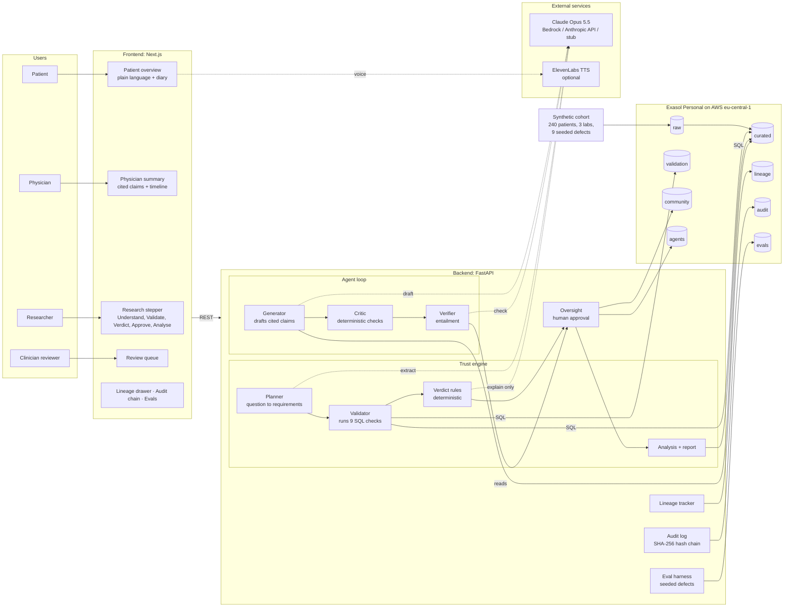
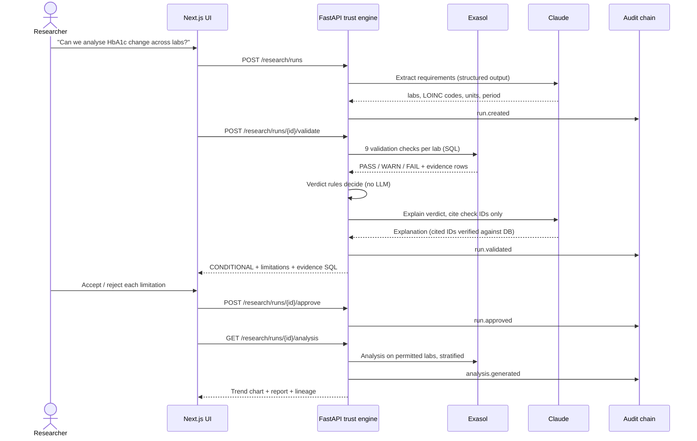
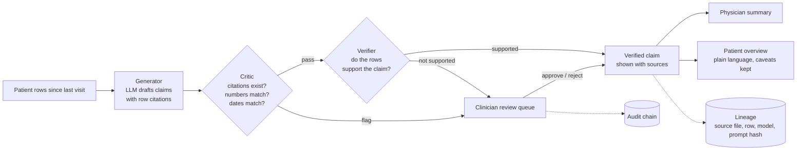

# TrustLens: Architecture

**Before the AI answers, it checks whether the data can answer.**

## 1. System overview

## 2. Trust flow (researcher)

## 3. Agent loop (physician / patient)

## Design principles

| Principle | How |
|---|---|
| Data before answers | Deterministic SQL checks in Exasol run before any analysis |
| The LLM never decides | Rules pick the verdict; Claude only extracts, explains and drafts, and every output is validated against the DB |
| Human in the loop | Researchers approve limitations; clinicians review flagged claims and patient reports |
| Every claim traceable | Lineage from source file to raw row to transform to model and prompt hash to claim |
| Tamper-evident | Hash-chained audit log, verifiable in one click |
| Privacy | Synthetic data only; k-anonymity (counts under 5 shown as "<5") in the community pool |
| Measured, not claimed | Seeded-defect evals: how many of the 9 known problems we catch |
