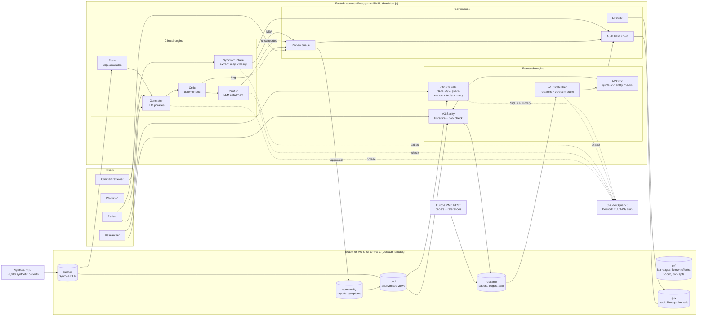
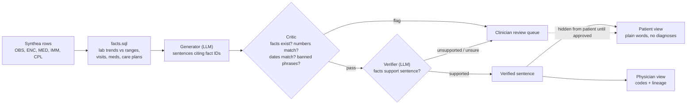
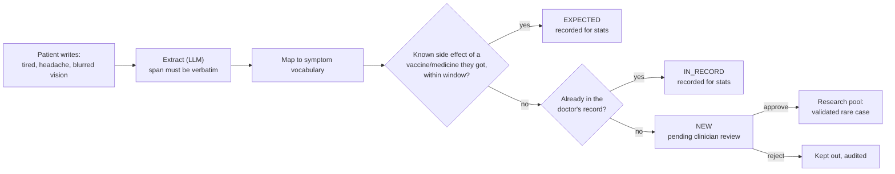
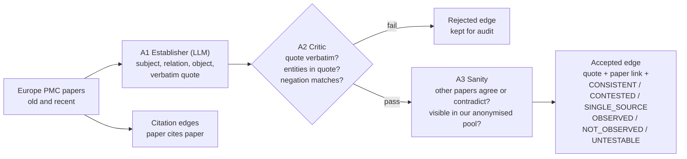
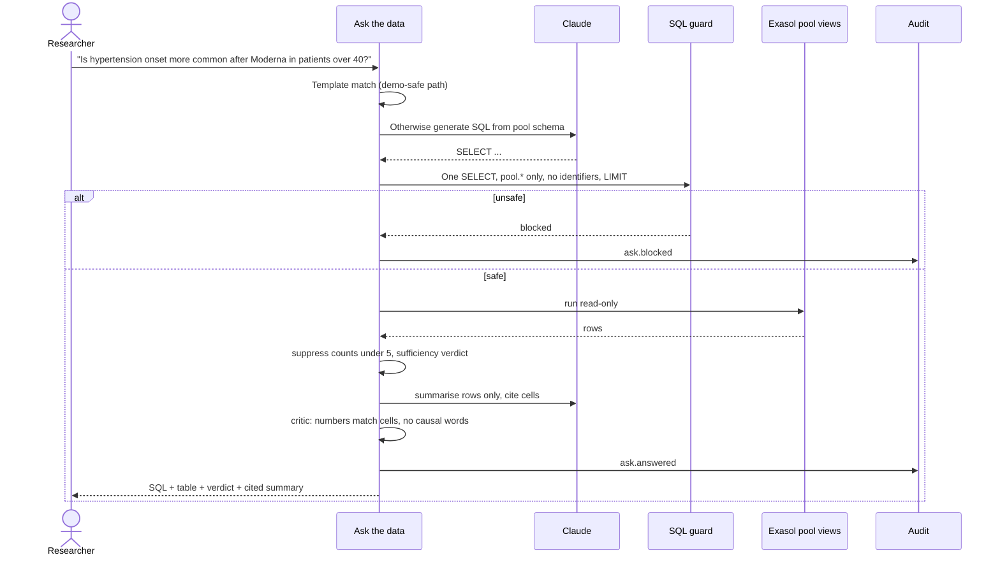

# TrustLens: Architecture (v2, MVP)

**Every AI sentence is backed by data you can click through to, checked by other agents, and signed off by a human where it matters.**

## 1. System overview

## 2. Evidence-backed summary (patient and physician)

## 3. Patient symptom loop

## 4. Research knowledge graph

## 5. Ask the data

## Design principles

| Principle | How |
|---|---|
| Evidence-backed | SQL computes facts; the LLM only phrases them. Graph edges need a verbatim quote |
| The LLM never decides | Critics, classification, verdicts and k-anonymity are deterministic rules |
| Multi-agent governance | Producer → critic → sanity/verifier; disagreements go to a human |
| Audited lineage | Every sentence, symptom, edge and answer traces to rows or papers, plus agent, model and prompt hash; hash-chained audit log |
| Privacy | Researchers only see anonymised views; counts under 5 shown as "<5"; synthetic data only |
| Honest demo | The planted research signal is labelled synthetic everywhere |
